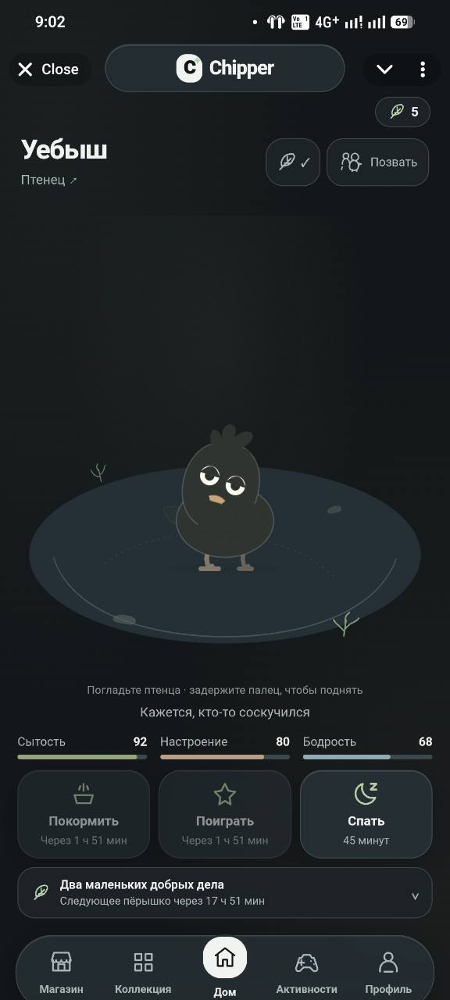
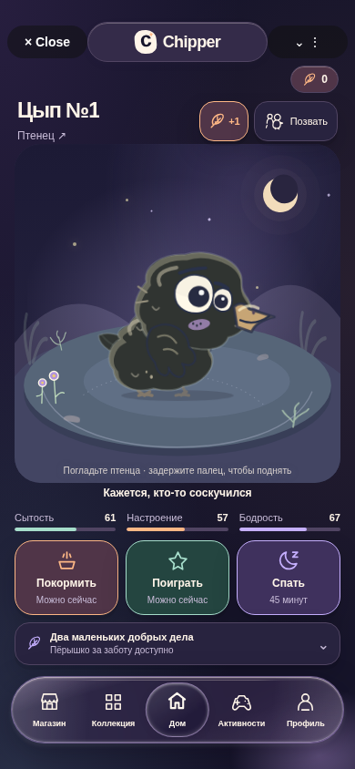

# Chipper 0.5 — acceptance result

**Автоматическая приёмка и визуальная проверка выполнены. Кандидат для бета-тестирования; физическая Telegram-приёмка и production preflight остаются владельцу. Production не изменён.**

Проверенный runtime: [c3b07c8](https://github.com/tracerxbrhd/chipper-hatchery/commit/c3b07c8c8a4ce4ded3361d86c982fa9d7c560b92). Точная база main:3764261bd7ab2531b87b47c240a3158022b02754. [Полный успешный CI38695995822](https://github.com/tracerxbrhd/chipper-hatchery/actions/runs/38695995822), job116292574585, 2026-10-15. Последующий commit сохраняет только отчёты и evidence. [Один открытый PR#5](https://github.com/tracerxbrhd/chipper-hatchery/pull/5), без merge.

## Реальные результаты

| Gate | Результат |
| --- | --- |
| npm ci, Node24, package-lock | PASS;213 packages,0 audit vulnerabilities |
| npm run check | PASS: TypeScript, ESLint,47 Vitest files /543 tests, build, server imports, production isolation, secret scan, contrast |
| npm run test:ui | PASS:103/103,3.1min, Chromium156.0.8078.4 |
| Production isolation | PASS: development backend, QA gallery and test identities excluded |
| Secret patterns | PASS:468 files /44 commits at runtime SHA; credential directories not read |
| Token/base-glass contrast | PASS:36/36 normal-text AA pairs; minimum4.57:1 |
| UI computed base-surface contrast | PASS: light minimum4.73:1, dark minimum6.37:1 among sampled headings/labels/cards/profile/dock; gradient/reflection pixels not claimed |
| Responsive browser matrix | PASS:320×568,360×640,390×844,430×932; light+dark; Home, pair, collection, comparison, Codex, profile, activities, social, incubator, settings, daily, shop and glass fallback |
| Canvas games | PASS: Flaps/Nest Defense both themes, controls inside synthetic native safe rectangle |
| Native Node/SQLite regression |12 groups PASS; care/daily/hatch/gifts/games/social/privacy/Codex/identity |
| Exchange/achievement native concurrency |6 groups PASS,10 independent SQLite writers, second-row abort rollback and exactly-once claims |
| Rig/world supplementary proof |36,900 anatomical frames /108,000 bounded steps /all5 comic actions PASS |
| Adapter lifecycle proof |7 synthetic-host scenarios PASS |
| Physical Android/iOS Telegram | MANUAL PENDING; browser emulation is not device acceptance |
| Live cloud identity/revision/SELECT preflight | NOT RUN; no bound owner CLI authorization |
| Cloud writes / DB migrations / reset / merge | NONE |

Full CI log excerpts: [ci-summary.txt](qa/0.5/ci-summary.txt). Original local npm/browser sandbox failures remain documented in [ENVIRONMENT_0.5.md](ENVIRONMENT_0.5.md); actual full suites ran in existing GitHub Actions, not through a local dependency substitution.

## Visual evidence and before/after

[Evidence index](qa/0.5/README.md) contains committed PNGs, eight geometry/style JSON records and a SHA256 manifest. [Full QA artifact](https://github.com/tracerxbrhd/chipper-hatchery/actions/runs/38695995822/artifacts/11954415464) contains every captured viewport/screen. [Playwright report](https://github.com/tracerxbrhd/chipper-hatchery/actions/runs/38695995822/artifacts/11954525382) contains all103 results and the actual attached performance sample.

| До: исходный Android владельца,0.4 | После: Chromium390px,0.5 |
| --- | --- |
|  |  |

Это разные устройства/fixture accounts, не контролируемый live A/B одного сохранения. Исходная фотография не изменена. После: реальный frontend и production services с local SQLite и синтетическим Telegram Android transport. В новом Home птица крупнее, тёмный силуэт отделён подсвеченной поляной, уход выделен цветом, dock имеет отражения и отдельную активную линзу.

[Галерея30 персонажей](qa/0.5/chick-gallery-v3.png):12 сохранённых палитр и3 возраста. [Точное сравнение рендереров](qa/0.5/chicks-before-after.png):12 пар с одинаковыми fixture ID, генами, палитрами и возрастами; старый SVG получен из exact main. Это реальные SVG/librsvg rasterizations. Visual3 меняет анатомию/выражение, сохраняя appearanceVersion2/geneSchema1; не выполняет reroll.

Просмотрены фактические captures: Home обеих тем/размеров, пара птиц, компактная Коллекция320, сравнение, профиль, Кодекс, обе Canvas-игры, магазин и обмен. На320 вертикальные списки и диалоги прокручиваются; навигация остаётся доступной. Физическую плавность, GPU blur и жесты браузерные captures не доказывают.

## Glass, motion и производительность

В реальном Chromium computed dock использует backdrop-filter blur(20px) saturate(1.45), alpha0.68, многослойные отражения и движущуюся линзу. В принудительном fallback: backdrop none, полностью непрозрачный фон, отражения скрыты. На390 dock366×74, нижняя граница816 при viewport844 и native bottom inset28; на320 dock304×68, нижняя граница540 при568. Все восемь metadata records показывают mainOverflow0 и pageErrors[]; care/tab targets превышают44px.

SVG idle меняет сохранённые rig nodes без замены artwork. Проверены все пять comics, рост/вылупление, sleep/care priority, touch/hold/release, guest read-only, native deactivation, reduced motion и остановка RAF/CSS при background. [Animation matrix](ANIMATION_0.5.md) отделяет реализованное поведение от ручной художественной приёмки.

[Реальный browser sample](qa/0.5/browser-perf.json), по2.5s,390×844:
- Home pair:149 frames, interval p95=16.8ms, DOM305→311,0 long tasks.
- Nest Defense:150 frames, p95=16.7ms, DOM57→57,0 long tasks.
- Background350ms:0 scheduled RAF для обоих.
- Reported heap10MB — coarse Chromium counter; он не доказывает отсутствие долговременной утечки. Эти короткие CI samples не являются FPS физического телефона.

| Production asset | main0.4 gzip kB |0.5 gzip kB |
| --- | --- | --- |
| Main JS |121.87 |133.15 |
| Main CSS |12.16 |18.89 |
| HTML |0.37 |0.36 |
| Lazy Nest Defense JS/CSS |11.17 /1.43 |11.18 /1.62 |

Initial HTML+JS+CSS:134.40→152.40kB gzip (+18.00kB,13.4%). QA PNG/SVG и документация не входят в production bundle. Нет shader/per-frame blur; rig обновляется императивно с ограничением30Hz.

## Сохранения, экономика и регрессии

Полный набор включает прежние daily/care/incubation/Flaps/Nest Defense, friendship/privacy/guest/gift, CAS, idempotency и verified identity сценарии. Existing schemaVersion2, appearanceVersion2, geneSchemaVersion1, release fence, ID/имена/возраста/ownership/исторические гены сохранены. DB schema и tgcloud.jsonc совпадают с main; новой DDL migration нет. Ни постоянные receipts, ни коллекции не удалены.

Двусторонний обмен подтверждён roadmap GDD0.3§11. Оба оригинала перемещаются атомарным pair CAS после согласия, повторной проверки дружбы/ownership/срока/reservations; rollback второй записи и lost-response retry проверены.12 достижений используют серверное состояние и постоянные bounded claim IDs; каждое+1 перо один раз, максимум12. Декоративные случайные события не начисляют валюту.

Магазин честно оставлен без checkout: saved roadmap относит marketplace/decor к0.6. Это документированное продолжение, не фиктивная покупка. Рост долговременных receipts/state_json и прежний глобальный поиск incoming gifts остаются в [AUDIT_0.5.md](AUDIT_0.5.md); опасной компактизации нет. Новые exchanges читают inbox по owner PK.

## Ручные gates владельца

1. Android и iOS в настоящем Telegram: native chrome/safe areas, keyboard, pet/hold/drag/release, tab transitions, background/resume, реальный blur/opaque fallback, reduced motion и длительная нагрузка.
2. Реальные аккаунты: friendship/privacy/block, gifts/exchanges с потерей сети и повтором, guest read-only; daily и achievement claim ровно один раз; обе игры.
3. Авторизованная read-only диагностика bot8924974998/@chipperhatcherybot: fetch/status/diff, строгий SELECT preflight и local migration dry-run по [runbook](DEPLOYMENT_0.5.md). При revision mismatch остановить release.
4. Отдельное явное разрешение на production deployment. Эта работа не включает cloud push/migrate/reset/webhook writes или merge PR. После первых0.5 transfers/claims backend0.4 нельзя использовать как наивный rollback.
